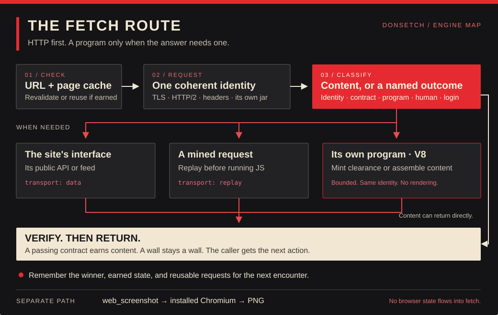

# Architecture

How the four tools share a local process, and where each part lives. [Back to the README](../README.md).

## Product and fetch layer

The Rust workspace has two crates: the product at the root and its fetching foundation in `crates/fetch/`. CLI and MCP are adapters over the same product engine. The tool spec in [src/spec.rs](../src/spec.rs) generates schemas and CLI arguments.

| Component | Owns | Source |
|---|---|---|
| Fetch layer | Client identities, carried state, cache, classification, interfaces, V8, mined requests | [crates/fetch](../crates/fetch/README.md) |
| DonSift | HTML extraction, typed blocks, reading views, headings, links, text quality | [src/extract](../src/extract/) |
| DonSeek | Query planning, keyless retrieval, merging, ranking, source health | [src/search](../src/search/) |
| DonTread | Site model (map), planner (plan, topic recall, family members), executor (run), digest (pN), delta/change memory, pacing, budgets, job resume | [src/crawl](../src/crawl/) |
| DonSheet | PDFium FFI, reading order, glyph/pixel fusion, tables, OCR, forms | [src/pdf](../src/pdf/) |
| Browser | Throwaway screenshots and diagnostic captures | [src/browser](../src/browser/) |
| MCP | Stdio and HTTP transport, compatibility output, supervisor | [src/mcp](../src/mcp/) |

## Fetch: carry the client, classify the answer

An encounter checks the page cache, sends a paced request with the selected identity and its own cookies, then classifies the response. A real document can return immediately. Otherwise, the class determines what to try: another identity, a native challenge hand-off, the site's own public interface, a stored request contract, or the page's own program.

These are available routes, not an unconditional chain. A native feed must answer the URL asked for; a front-page listing cannot substitute for a specific article. A successful status code alone is not content.

### Eight coherent clients

| Identity | Client |
|---|---|
| `plain` | Plain HTTP client |
| `chrome-local` | Captured Chrome 156 / Linux identity and script-visible facts |
| `chrome` | Chrome 156 / Linux |
| `chrome-win` | Measured Chrome 156 / Windows |
| `chrome-android` | Measured Chrome 149 / Android |
| `firefox` | Firefox 151 |
| `safari` | Safari 26.4 / macOS |
| `okhttp` | OkHttp 5 / Android app |

A profile carries TLS, HTTP/2, header values/order, and client hints together. Versions are the measured profiles, not a claim to match the newest installed browser. An origin's winner is reused until it fails; vendor and global priors guide new encounters. Cookies and clearance stay bound to the client that earned them.

### The same V8 engine, two jobs

| Mode | Runs | Produces |
|---|---|---|
| Challenge | The challenge page's scripts, on the same network identity | A credential or navigation to spend and re-classify |
| Content | The application's scripts against a data-only DOM | A document that must pass the content contract |

There is no browser process, CSS layout, or raster in this path. Script-visible facts come from measured captures or the document's declared data. A content run is skipped when the served document already passes.

After a successful content run, request mining can find the JSON request whose records appear in the assembled document. It stores method, URL template, headers, body, and the expected item structure, bound to host, identity, and URL shape. Later encounters replay it before JS. A refusal or structural break drops the contract and allows re-mining.

The engine is bounded outside page code: 256 MB JS heap, 128 MB live typed-array backing store, 128 MB WebAssembly memory, 96 ops, and one engine at a time per process. Default wall ceilings are 10 seconds for a mint and 5 seconds for content, within the remaining encounter deadline. URL, DNS, redirect, and response-size guards apply to engine requests too.

### State and freshness

Learned fetch state is local under `<cache>/v5/state.json`: per-origin identity scores, vendor priors, routes, pacing, cookie jars, minted credentials, mined requests, and cache trust. It is bounded to 4,096 origin records and merges writes under a file lock.

Verified pages live beside it in an identity/egress/URL-keyed cache. Repeat reads normally revalidate with the origin. Freshness without a request must be earned through unchanged checks and is capped at 60 seconds. Validator audits can distrust a lying origin for seven days. `no-store`, `Vary: *`, and cookie variation constrain reuse.

Product page history is separate: it records fingerprints and previous content for change reports and `since_last`.

The fetcher stores no login credentials, imports no browser clearance, and never signs in. `DONSEEK_NO_DISK_STATE=1` keeps learned state in memory. [Setup and cache location →](setup.md#configuration)

## Search: rank what the sources actually returned

1. **Understand.** Parse identifiers, query shape, entities, operators, dates, and explicit language.
2. **Plan.** Select registries, first-party records, news, or general indexes within a request budget.
3. **Admit.** Reject hard violations such as excluded terms, off-scope URLs, wrappers, and duplicates.
4. **Merge.** Count agreement across measured index families; sibling indexes do not become independent votes.
5. **Rank.** Use BM25+, RM3 feedback, and a compiled 22-feature linear ranker for code, how-to, and shopping queries. Other shapes keep fusion ordering.
6. **Report.** Return source status, evidence snippets, completeness, and retrieval confidence.

The ranker is trained offline and gated on held-out queries. Search opens no ONNX session and downloads no model. High-confidence merged answers may be cached with their age. Source pacing and refusals survive process restarts. A 403/429 is a wait, not a reason to evade the source's refusal.

Google's default source uses the native search-element request contract, not a rendered browser page. [Google source notes →](google-wml.md)

## Extraction, PDF, and crawl

DonSift builds typed content blocks with section breadcrumbs, removes page furniture, and applies the requested view. Focus uses multilingual lexical scoring; presence checks preserve uncertainty when a source is incomplete.

DonSheet gets glyphs and rendered pixels from PDFium. Pixel structure supplies borders and table rules; glyphs supply text. Region-level audits decide where OCR is needed. OCR is optional and lazy; ONNX belongs to that path only.

DonTread's `map` builds the v6 site model from the site's own inventory (`llms.txt`, sitemaps, feeds, seed links) — templates, families, sections and a dossier — without reading a content page. `plan` spends that model on a page budget: it answers every focus topic first (one page per named term the inventory can answer), then covers sections and families, then deepens into a family's own members, with reserves, a reason and cost per row, no fetch. The inventory carries the site's own labels (seed link text, `llms.txt` titles), so a page is found by the name the site uses, not only its slug. `run` spends the plan through v5: one page at a time per host, host request budget, durable job, resume, and a host circuit breaker that declares a classified wall instead of retrying page by page. Its response is a digest — brief, page cards whose size follows the page budget, stable `pN` handles, headings and focus passages, repeated boilerplate removed — and `crawl get pN` reads the full stored page from the job with no network. Dataset v3 carries the same card fields plus full markdown. The dossier (v4) stores the change contract, bounded inventory with the site's own labels, and per-URL fingerprint/lastmod memory; `crawl diff` uses it to fetch only changed/new pages and report removed URLs, while `crawl sites`/`forget` list or remove a host's memory. `full` is the v6 plan + executor path, on the same v5 fetch and extraction pipeline; per-host pacing and shared host state prevent parallel crawls from doubling the rate. `map`, `plan`, `full`, `diff`, `get` and job `resume` are the crawl contract.

Screenshots use a separate installed browser and return PNGs. They never supply cookies, tokens, or content to fetch.

## Boundaries

Fetch is for agentic research. Login and human-interaction walls remain explicit outcomes. Content that requires layout or pixels is not fabricated. [Tool contracts](tools.md) describe what callers receive; the [fetch crate README](../crates/fetch/README.md) owns the detailed mechanism and limits.
