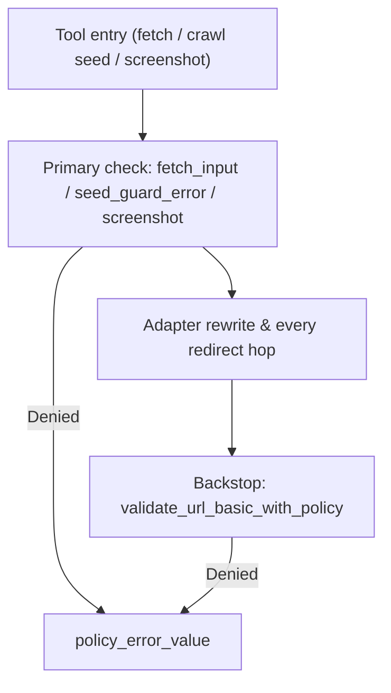

# Local rules: architecture

Maintainer reference for `src/rules.rs` and its enforcement points. Operator behavior lives in [rules.md](rules.md); keep both files in step whenever rule semantics or error routing change.

## Components

| Piece | Location | Responsibility |
|---|---|---|
| Config schema | `src/rules.rs` (`RulesSection`, `UrlRule`), `src/config.rs` | `[rules]` scalars in fieldbook + `[rules.url."<pattern>"]` with `deny_unknown_fields`; rejects any other `DONSETCH_RULES*` env var |
| Compiler & matcher | `RuleSet::compile`, `eval`, `matches`, `denial` | Strict canonical-key validation, duplicate check, URL host normalization, O(labels) suffix lookup, winner-takes-all precedence |
| Process singleton | `rules()` (`OnceLock`) | Populated from `cfg().rules`; empty `RuleSet` when `mode = "off"` |
| Error variant | `FetchError::Denied` (`src/error.rs`), `NonHttpRedirect` | Self-contained payload (`rule`, `message`, `kind`, `reason`, `url`); `Display` emits fixed text only (`excluded by the operator's local DonSeTch rules`) so downstream substring classifiers (`error_code`, `lane_note`) can never misfire on operator prose |
| Guard core | `validate_url_basic_with_policy` (`src/fetch/guards.rs`) | Shared backstop after scheme/userinfo/host checks and before SSRF (so a deny holds even when `fetch.allow_private_egress = true`) |
| Tool formatter | `policy_error_value` (`src/mcp/server/errors.rs`) | Builds structured `ok: false` result (`code: "policy.denied.<reason>"`, `errorKind`, `rule`, `next_action`) via `tool_error_structured` |

## Matching & precedence invariants

- **Compile-time canonical keys, never silent normalization:** TOML tables merge byte-exact before compilation, so accepting `Example.ORG` alongside `example.org` would create two rules instead of overriding one. `compile` rejects non-canonical keys with a prescriptive fix message and runs a compiled-pattern duplicate check as a backstop.
- **URL normalization inside `eval`:** uses `url::Url`'s lowercase punycode host, strips trailing dots, and unwraps IPv4-mapped IPv6 (`[::ffff:a.b.c.d]` → `a.b.c.d`, matching `is_ssrf_host`).
- **Winner-takes-all:** ranks by `(label_count, exact_over_tree, single_scheme_over_both, key_tiebreak)`. Per-field cascading was rejected so an omitted `action` (default `"allow"`) in a narrow rule is explicit and deterministic rather than depending on optional-field merge state.

## Enforcement points

1. **Primary tool entry:** `fetch_input` in `web_fetch` (before persona, lane, prewarm cache, or Unlocker cache, matching `Denied` ahead of `guard.ssrf`), `seed_guard_error` in `src/mcp/server/crawl_tool.rs` (checking both `seed` and `adapters::rewrite`), and `web_screenshot` entry + CDP `Fetch.requestPaused` document guard.
2. **Universal backstop (`validate_url_basic` / `ensure_url_safe`):** covers adapter rewrites, every redirect hop (`validate_redirect_url`), keyless search engine requests, search result prefetch, crawl `robots.txt`/sitemaps/pages, and `doctor`.
3. **Explicit downstream arms:** `fetch_error_kind`, `fetch_error_code` (`policy.denied.unspecified` fallback if a callsite ever stringifies `Denied`), `lane_note` (never blames the proxy lane), `state_probe` (no failure recorded), search engine census (`invalid-config:`, never quarantining engine health), and search prefetch (leaves rank and host quality untouched).

## Crawl integration (`src/crawl/`)

- **Seed & robots:** `seed_guard_error` rejects denied seeds or denied adapter rewrites upfront before touching any job state; a seed that redirects into a denied host with nothing else to fetch surfaces through `SeedFailure.denial` (`requested_url` + `landing_url`). `RobotsCache::ensure` skips fetching `robots.txt` for a denied origin so a local rule is never misreported as `robots` disallow-all.
- **Execution (`executor.rs`, `real.rs`):** every page fetch passes through `Fetcher` guards (covering adapter rewrites and redirect hops) and carries any refusal on `FetchedPage.denied` instead of flattening it into a network error. `executor::execute` records `(url, policy_skip_reason(denial))` in `job.skipped` without retrying or penalizing `Governor` host pacing.
- **Receipts (`crawl_tool.rs`):** `crawl_complete` and `compute_crawl_next_action` check `is_policy_skip` (`policy.denied.` prefix) and `DeniedLog` ahead of generic substring heuristics so rule keys containing `wall` or `404` cannot misclassify the crawl.

## Testing & fixed decisions

- Pure `RuleSet` compile/match/`validate_url_basic_with_policy` tests run anywhere; tests reading process-wide `rules()` require `cargo nextest` isolation and state so in comments.
- **Do not reopen:** rules ship empty; pattern-keyed TOML map with `enabled = false` tombstones; broken rules fail startup; no catch-all pattern; `--ignore-rules` is CLI-only; search hits are never dropped or reordered; `kind` is restricted to `walled` or `permanent` (never `transient`).
